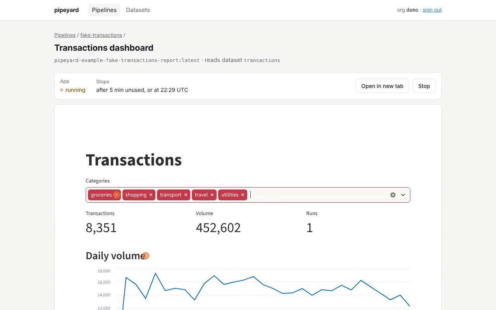
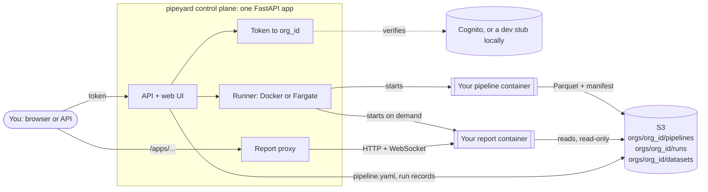

# pipeyard

**Bring your containers. Get datasets and dashboards.**

You already have code that produces data: a scraper, an export job, a model that scores
things. And you have a favourite way to look at data: Streamlit, Dash, Shiny, whatever.
pipeyard runs both without making you learn a framework. Package each as a container,
describe them in a dozen lines of YAML, and pipeyard will run the pipeline, keep every
run's output as Parquet in S3, and serve your dashboard behind a sign-in.

[](docs/demo.mp4)

**[Watch the walkthrough](docs/demo.mp4)**: register a pipeline, trigger a run, start its
report.

## How it works

1. **You bring two containers and a `pipeline.yaml`.** One container produces data, the
   other is a web app that shows it. The YAML names them both.
2. **pipeyard runs the pipeline** (Docker on your laptop, Fargate in AWS) and tells it
   where to write.
3. **Your pipeline writes Parquet** to that location and exits.
4. **pipeyard serves the report, and scales it to zero.** When someone opens it, pipeyard
   starts your report container, points it at the data, and passes the signed-in browser
   through to it. A few minutes after the last person leaves, it stops the container.

That is the whole product. There is no database, no scheduler and no SDK to import. A
pipeline container reads two environment variables and writes files to S3. A report
container listens on a port.

```yaml
name: fake-transactions
image: pipeyard-example-fake-transactions:latest
outputs:
  - dataset: transactions
reports:
  - name: Transactions dashboard
    image: pipeyard-example-fake-transactions-report:latest
    dataset: transactions
```

## Try it in 5 minutes

You need Docker and [mise](https://mise.jdx.dev). (No mise? Install Python 3.12,
[uv](https://docs.astral.sh/uv/) and [go-task](https://taskfile.dev) yourself.)

```sh
mise install     # pinned versions of python, uv, task, node, awscli and cdk
task up          # local S3 + pipeyard on http://localhost:8000 (leave it running)
```

In a second terminal:

```sh
task demo        # registers the example, runs the pipeline, starts its report
```

Now open <http://localhost:8000>. You are signed in as the org `demo`, and you will find:

- **Pipelines**: the example, its runs, and a **Trigger run** button. Press it and watch the
  status go from running to succeeded.
- **Datasets**: `transactions`, with its schema and row count.
- **Reports**: **Transactions dashboard**, a Streamlit app running in its own container.
  Filter the categories and the charts update live. Close the tab, and five minutes later
  the container is gone; open the report again and it comes back.

The first `task up` and `task demo` take a few minutes because they build the local AWS
emulator (about a 200 MB download) and the Streamlit example image. After that everything
starts in seconds. When you are done, `task down`.

> Local data lives in memory. Stopping the emulator wipes every pipeline, run and dataset,
> which makes it a safe place to experiment. More in
> [docs/local-development.md](docs/local-development.md).

## Bring your own containers

The [tutorial](docs/your-first-pipeline.md) builds both kinds from scratch in about
fifteen minutes. In short:

**A pipeline container** is a job. pipeyard starts it with:

| Variable | What it is |
|---|---|
| `RUN_ID` | A unique id for this run |
| `OUTPUT_URI` | Where to write, e.g. `s3://bucket/orgs/demo/datasets/orders/run=<run_id>/` |

It writes one or more `*.parquet` files there, then a small `_manifest.json`, then exits
with code 0. Anything else is a failed run, and the UI tells you why.

**A report container** is a web app, in any framework. pipeyard starts it with:

| Variable | What it is |
|---|---|
| `PORT` | The port to listen on |
| `BASE_PATH` | The URL prefix it is served under, e.g. `/apps/coffee-orders/coffee-dashboard` |
| `INPUT_URI` | Where its dataset lives, e.g. `s3://bucket/orgs/demo/datasets/orders/` |

It serves HTTP (and WebSockets, if it likes) on that port. pipeyard starts it when someone
opens the report and stops it once nobody has used it for `idle_timeout_seconds`, 5 minutes
by default. A report nobody is looking at costs nothing.

Both get `ORG_ID` and ordinary `AWS_*` credentials, which every AWS SDK picks up by itself.
A report's credentials are read-only.

**Register** them by pressing **Register pipeline** in the UI and pasting the YAML. If
something is wrong you get a list of exactly what to fix, and nothing is saved until it is
valid.

The complete rules, the manifest format and every error message are in
[docs/container-contract.md](docs/container-contract.md).

## Architecture



A few choices keep it small:

- **S3 is the only storage.** Pipelines are YAML objects, run records are JSON objects, data
  is Parquet. The lists in the UI are DuckDB queries over a prefix.
- **Almost no background work.** A run's outcome is settled the next time anyone looks at
  it. The one thing that runs on a clock is a small sweep that stops idle reports.
- **One process.** The API and the UI are the same FastAPI app. The UI is server-rendered
  HTML with HTMX, so there is no front-end build.
- **Multi-tenant-ready.** v0 serves one org, but `org_id` is part of every S3 key, token,
  IAM session and API call, so serving many orgs later is configuration, not a rewrite.

[docs/how-it-works.md](docs/how-it-works.md) follows a run and a report from click to screen and explains
where everything is stored.

## Built to keep orgs apart

Even with one org today, isolation is designed in and tested:

- **The org comes from your sign-in token and nowhere else.** No URL, query string or
  request body can name another org.
- **Report apps are only reachable through pipeyard.** Every request to one is checked
  against your sign-in first, and your token is stripped before the request is passed on,
  so a report container never holds anything it could use against the API.
- **In AWS, IAM enforces it again.** Every S3 call, from your containers and from pipeyard
  itself, uses credentials that are only valid for `orgs/{your org}/`. Report containers
  get read-only ones.

`tests/test_org_scoping.py` and `tests/test_reports.py` prove it: a second org gets a 404
for everything belonging to the first, including its running report apps.

## Deploy to your AWS account

```sh
task bootstrap                         # once per account and region
task deploy -- -c org_id=acme          # 5 to 10 minutes
task create-user EMAIL=you@example.com PASSWORD='Choose-a-strong-1!'
task push-example                      # put the example images in ECR
task demo-aws                          # the same demo, now on Fargate
```

One CDK stack creates an S3 bucket, an ECR repository, an ECS cluster, pipeyard itself on
Fargate behind a load balancer, and a Cognito user pool for sign-in.

> **Read this first.** The AWS path is covered by `cdk synth`, template assertions and
> stubbed AWS clients, but **it has not yet been deployed to a real account**. Expect to
> fix a detail or two on the first deploy. And v0 makes deliberate cost-saving tradeoffs:
> public subnets with open egress, and plain HTTP unless you supply a certificate.

[docs/deploy-aws.md](docs/deploy-aws.md) has the full steps, what gets created, and each
tradeoff with its fix.

## Not yet

v0 is deliberately small. These are known gaps, not oversights:

- Schedules: runs are triggered by hand
- Reports that stay up longer than 50 minutes at a stretch (they restart when reopened)
- Built-in SQL or chart reports: a report is always your own container
- More than one output dataset, or more than one input, per pipeline
- A multi-org admin UI and org onboarding
- Billing and metering
- Image signing and provenance checks
- Egress controls for run containers
- A catalogue (DuckLake, S3 Tables): datasets are plain Hive-partitioned Parquet
- Run logs in the UI for AWS runs (they are in CloudWatch Logs)

## Documentation

| | |
|---|---|
| [Your first pipeline](docs/your-first-pipeline.md) | Tutorial: build a pipeline and a dashboard, register and run them, in fifteen minutes |
| [The container contract](docs/container-contract.md) | Reference: `pipeline.yaml`, what pipeline and report containers get and must do, every error |
| [How it works](docs/how-it-works.md) | A run and a report from click to screen, the storage layout, the API, how orgs are isolated |
| [Local development](docs/local-development.md) | The task commands, the AWS emulator, tests, troubleshooting |
| [Deploying to AWS](docs/deploy-aws.md) | Step by step, what is created, v0 tradeoffs |

## For contributors

```sh
task test        # 112 tests against the local emulator
task lint        # ruff
```

```
src/pipeyard/
  contract.py   the rules: pipeline.yaml, manifest, run record, S3 key layout
  storage.py    S3 reads and writes, org-scoped credentials
  query.py      DuckDB: the run and dataset lists
  runner.py     one interface, two runners: Docker and Fargate
  proxy.py      forwards browsers to report apps, HTTP and WebSocket
  auth.py       token to org_id (dev stub or Cognito)
  app.py        the API and the UI
  templates/    Jinja + HTMX pages
examples/pipelines/fake-transactions/   the example pipeline and its Streamlit report
infra/          the CDK stack
scripts/demo.py the end-to-end demo
```

Python 3.12 with FastAPI, DuckDB, pydantic, boto3, httpx, websockets and PyJWT. Eight
modules, no framework beyond that.
