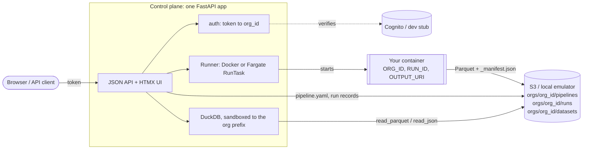

# pipeyard

Bring your own container, get a dataset and a report.

A pipeyard pipeline is a container image plus a `pipeline.yaml`. pipeyard runs the
container, the container writes Parquet to S3, DuckDB queries it, and a small web UI shows
the reports defined in the YAML.

v0 is **single-tenant and deployed into your own AWS account**, but `org_id` is threaded
through every S3 key, token claim, IAM session and API call, so serving several orgs from
one deployment later is configuration rather than a rewrite.



There is no database. Pipelines, run records and manifests are objects in S3; lists are
`read_json` over a prefix. There is no background worker either: a run's status is settled
the next time someone reads it.

## Local quickstart (5 minutes)

You need Docker and [mise](https://mise.jdx.dev) (or install Python 3.12, uv and
[go-task](https://taskfile.dev) yourself).

```sh
mise install        # python, uv, task, node, awscli, cdk at pinned versions
task up             # AWS emulator + control plane on http://localhost:8000 (leave running)
```

In a second terminal:

```sh
task demo
```

`task demo` builds the example image, registers `examples/pipelines/fake-transactions`,
triggers a run (about 10,000 fake transactions), waits for it, and prints the first rows of
the "Daily volume" report. Then open <http://localhost:8000>: the pipelines list, the
pipeline's runs and trigger button, the datasets list and both reports (table + chart).

In local mode you are signed in automatically as org `demo`.

Local S3 is [moto server](https://docs.getmoto.org/en/latest/docs/server_mode.html), an
open-source emulator of the AWS APIs, on <http://localhost:4566>. Any credentials work,
for example `AWS_ACCESS_KEY_ID=x AWS_SECRET_ACCESS_KEY=x aws --endpoint-url
http://localhost:4566 s3 ls --recursive s3://pipeyard/`. Its state is **in memory**:
`task down` or a restart of the emulator clears every pipeline, run and dataset.

| Task | What it does |
|---|---|
| `task up` / `task down` | Start / stop the local stack |
| `task demo` | The end-to-end example |
| `task test` | Tests (they use the emulator as their S3, and a fake runner) |
| `task lint` / `task fmt` | Ruff |
| `task synth` / `task deploy` | CloudFormation template / deploy to AWS |

> **Why moto and not LocalStack?** The LocalStack image now exits at start-up without a
> `LOCALSTACK_AUTH_TOKEN`. To use it anyway, set `AWS_EMULATOR_IMAGE` and adjust the port
> mapping in `docker-compose.yml`. If Docker Hub rate-limits the Python base image, run `BASE_IMAGE=public.ecr.aws/docker/library/python:3.12-slim task demo`.

## Writing a pipeline

```yaml
name: fake-transactions
image: <ecr-or-local-image>
cpu: 256
memory: 512
timeout_seconds: 600
outputs:
  - dataset: transactions
reports:
  - name: Daily volume
    dataset: transactions
    sql: |
      select date_trunc('day', ts) as day, sum(amount) as total
      from {{dataset}} group by 1 order by 1
    chart: { type: line, x: day, y: total }
```

The container gets `ORG_ID`, `RUN_ID`, `OUTPUT_URI` (and `INPUT_URI` if it declares an
input) plus standard `AWS_*` credentials. It must write Parquet files under `OUTPUT_URI`,
then `_manifest.json`, then exit 0. Its root filesystem is read-only; `/tmp` is scratch.
A non-zero exit, a missing or invalid manifest, or no Parquet means a failed run.

The full contract, including the manifest format and every failure message, is in
[docs/container-contract.md](docs/container-contract.md).

Register with `POST /api/pipelines` (body: the YAML). The API:

| Method and path | |
|---|---|
| `POST /api/pipelines` | Register or replace a pipeline (422 with a list of errors if invalid) |
| `GET /api/pipelines`, `GET /api/pipelines/{name}` | |
| `POST /api/pipelines/{name}/runs` | Trigger a run |
| `GET /api/pipelines/{name}/runs`, `GET /api/runs/{run_id}` | |
| `GET /api/datasets` | From manifests |
| `GET /api/pipelines/{name}/reports/{slug}` | Run a report |

Send `Authorization: Bearer <token>`. Locally, `POST /dev/token` issues one for org `demo`.

## How orgs are kept apart

- **The org comes from the token and nowhere else.** No route accepts an org in its path,
  query or body. `contract.py` is the only place S3 keys are built and every helper starts
  from `orgs/{org_id}/`.
- **Report SQL is sandboxed.** v0 only runs SQL written in `pipeline.yaml`, and only a
  single `SELECT`. Each query gets a fresh in-memory DuckDB whose S3 secret is scoped to
  the org prefix, with external access disabled outside that prefix and configuration
  locked. Datasets are exposed as views over committed runs.
- **In AWS, IAM enforces it too.** There is one "run role" whose policy only allows
  `orgs/${aws:PrincipalTag/org_id}/*`. The control plane assumes it with an `org_id`
  session tag and uses those credentials for the run container, for DuckDB and for its own
  S3 calls. The control plane's own role has no S3 permissions.
- `tests/test_org_scoping.py` proves that org B gets 404 for everything of org A, that
  hostile report SQL cannot read another org's objects or local files, and that forged,
  expired or unsigned tokens are rejected.

## Deploy to AWS

You need AWS credentials with rights to create the stack, and Docker running (CDK builds
the control plane image).

```sh
task bootstrap                         # once per account/region
task deploy -- -c org_id=acme          # 5-10 minutes; org_id defaults to "demo"
task outputs                           # URL, bucket, ECR repo, user pool
task create-user EMAIL=you@example.com PASSWORD='Choose-a-strong-1!'
task push-example                      # build + push the example image to ECR

export PIPEYARD_USERNAME=you@example.com PIPEYARD_PASSWORD='Choose-a-strong-1!'
task demo-aws                          # same flow as local, on Fargate
```

Then open the `Url` output and sign in. Run logs go to the `RunLogGroup` output in
CloudWatch Logs.

What `task deploy` creates (one CDK stack, `infra/stack.py`):

- S3 bucket (private, encrypted, TLS only, retained on destroy) and an ECR repository
- ECS cluster and a **run task definition template**: read-only root filesystem, `/tmp`
  scratch volume, CloudWatch logging, and a `timeout` sidecar that stops the task after
  `timeout_seconds` even if the control plane is down. The control plane copies the
  template per pipeline, swapping in the image, cpu and memory.
- The control plane as a Fargate service behind an Application Load Balancer
- A Cognito user pool (no self sign-up) whose `custom:org_id` attribute is immutable and
  not writable by the app client
- The ABAC run role described above

### v0 tradeoffs to know about

- **Public subnets, public IPs, no NAT.** Tasks need to reach ECR, S3, STS and CloudWatch,
  and a NAT gateway or VPC endpoints would dominate the bill of an idle stack. Security
  groups allow no inbound traffic to run tasks and only the load balancer to the control
  plane, but **egress is open**: a pipeline container can call anything on the internet.
  The next step is private subnets with VPC endpoints and an egress allow-list.
- **HTTP by default.** Without a domain there is no certificate, so the load balancer
  listens on plain HTTP and the sign-in form posts your password over it. For anything
  beyond a quick trial, pass an ACM certificate and point your domain at the load
  balancer: `task deploy -- -c certificate_arn=arn:aws:acm:...`. That switches to HTTPS,
  redirects HTTP and marks the session cookie `Secure`.
- **Run credentials are passed as environment variables** on the ECS task and last one
  hour (the limit when one role assumes another), which is why `timeout_seconds` is capped
  at 3600. They are org-scoped and short-lived, but visible to anyone in the account who
  can describe ECS tasks.
- **A task definition revision is registered per run.** Harmless, but they accumulate.
- The control plane is a single task. A run triggered during a redeploy is not lost (its
  record is in S3 and is reconciled on the next read).

The AWS path has been checked with `cdk synth`, assertions on the synthesized template and
stubbed AWS clients (`tests/test_aws_mode.py`). **It has not yet been deployed to a real
account**, so expect to shake out a detail or two on the first `task deploy`.

## Layout

```
src/pipeyard/
  contract.py   pipeline.yaml / manifest / run-record models and the S3 key layout
  storage.py    S3 reads and writes, org-scoped credentials
  query.py      DuckDB: lists via read_json, sandboxed report SQL
  runner.py     Runner interface, DockerRunner, FargateRunner
  auth.py       token -> org_id (dev stub or Cognito)
  app.py        FastAPI routes: /api/* and the UI
  templates/    Jinja + HTMX, Vega-Lite from a CDN
examples/pipelines/fake-transactions/   the example pipeline
infra/          CDK app (one stack)
scripts/demo.py the end-to-end demo, local and AWS
docs/container-contract.md
```

Runtime dependencies: FastAPI, uvicorn, Jinja2, DuckDB, pydantic, PyYAML, boto3, PyJWT.

## Not yet

- Billing and metering
- Schedules (runs are triggered manually)
- Arbitrary or ad-hoc SQL (only reports defined in `pipeline.yaml`)
- App-style report containers (Streamlit and friends)
- A multi-org admin UI and org onboarding
- Image signing and provenance checks
- Egress controls for run containers
- A catalogue (DuckLake, S3 Tables); datasets are plain Hive-partitioned Parquet
- More than one output dataset per pipeline, and more than one input
- Registering pipelines from the UI (use the API or `scripts/demo.py`)
- Run log viewing in the UI for AWS runs (use CloudWatch Logs)
