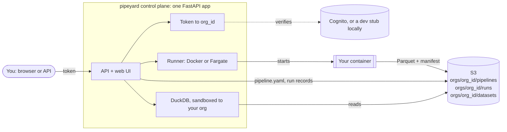

# pipeyard

**Bring a container. Get a dataset and a dashboard.**

You already have code that produces data: a scraper, an export job, a model that scores
things. pipeyard turns it into a pipeline without making you learn a framework. Package the
code as a container, describe it in a dozen lines of YAML, and pipeyard will run it, keep
every run's output as Parquet in S3, and chart the results in a small web UI.

[](docs/demo.mp4)

**[Watch the 50-second walkthrough](docs/demo.mp4)**: register a pipeline, trigger a run,
see the dataset and its reports.

## How it works

1. **You bring a container and a `pipeline.yaml`.** The YAML names the image, the dataset it
   produces, and the SQL reports you want.
2. **pipeyard runs it** (Docker on your laptop, Fargate in AWS) and tells it where to write.
3. **Your container writes Parquet** to that location and exits.
4. **pipeyard serves the results**: DuckDB runs your report SQL straight over the Parquet
   files and the UI shows a table and a chart.

That is the whole product. There is no database, no scheduler and no SDK to import. Your
container only needs to read three environment variables and write files to S3.

```yaml
name: fake-transactions
image: pipeyard-example-fake-transactions:latest
outputs:
  - dataset: transactions
reports:
  - name: Daily volume
    dataset: transactions
    sql: |
      select date_trunc('day', ts) as day, sum(amount) as total
      from {{dataset}} group by 1 order by 1
    chart: { type: line, x: day, y: total }
```

## Try it in 5 minutes

You need Docker and [mise](https://mise.jdx.dev). (No mise? Install Python 3.12,
[uv](https://docs.astral.sh/uv/) and [go-task](https://taskfile.dev) yourself.)

```sh
mise install     # pinned versions of python, uv, task, node, awscli and cdk
task up          # local S3 + pipeyard on http://localhost:8000 (leave it running)
```

In a second terminal:

```sh
task demo        # registers the example pipeline, runs it, prints the report
```

Now open <http://localhost:8000>. You are signed in as the org `demo`, and you will find:

- **Pipelines**: the example, its runs, and a **Trigger run** button. Press it and watch the
  status go from running to succeeded.
- **Datasets**: `transactions`, with its schema and row count.
- **Reports**: a line chart of daily volume and a bar chart by category.

The first `task up` takes a few minutes because it builds the local AWS emulator (about a
200 MB download). After that it starts in seconds. When you are done, `task down`.

> Local data lives in memory. Stopping the emulator wipes every pipeline, run and dataset,
> which makes it a safe place to experiment. More in
> [docs/local-development.md](docs/local-development.md).

## Bring your own container

Three steps. The [tutorial](docs/your-first-pipeline.md) walks through them with a
complete, copy-pasteable example in about ten minutes.

**1. Make your container follow the contract.** pipeyard starts it with:

| Variable | What it is |
|---|---|
| `RUN_ID` | A unique id for this run |
| `OUTPUT_URI` | Where to write, e.g. `s3://bucket/orgs/demo/datasets/orders/run=<run_id>/` |
| `ORG_ID` | The org the run belongs to |

plus ordinary `AWS_*` credentials, which every AWS SDK picks up by itself. Your code writes
one or more `*.parquet` files under `OUTPUT_URI`, then a small `_manifest.json`, then exits
with code 0. Anything else is a failed run, and the UI tells you why.

**2. Describe it in a `pipeline.yaml`** like the one above.

**3. Register it.** Press **Register pipeline** in the UI and paste the YAML. If something
is wrong you get a list of exactly what to fix, and nothing is saved until it is valid.

The complete rules, the manifest format and every error message are in
[docs/container-contract.md](docs/container-contract.md).

## Architecture



A few choices keep it small:

- **S3 is the only storage.** Pipelines are YAML objects, run records are JSON objects, data
  is Parquet. Lists are DuckDB queries over a prefix.
- **No background worker.** A run's outcome is settled the next time anyone looks at it.
- **One process.** The API and the UI are the same FastAPI app. The UI is server-rendered
  HTML with HTMX, so there is no front-end build.
- **Multi-tenant-ready.** v0 serves one org, but `org_id` is part of every S3 key, token,
  IAM session and API call, so serving many orgs later is configuration, not a rewrite.

[docs/how-it-works.md](docs/how-it-works.md) follows a run from click to chart and explains
where everything is stored.

## Built to keep orgs apart

Even with one org today, isolation is designed in and tested:

- **The org comes from your sign-in token and nowhere else.** No URL, query string or
  request body can name another org.
- **Report SQL runs in a sandbox.** Only a single `SELECT` from `pipeline.yaml` is ever
  executed, in a throwaway DuckDB that can read your org's prefix and nothing else: not
  other orgs, not local files.
- **In AWS, IAM enforces it again.** Every S3 call, from your container, from DuckDB and
  from pipeyard itself, uses credentials that are only valid for `orgs/{your org}/`.

`tests/test_org_scoping.py` proves it: a second org gets a 404 for everything belonging to
the first, and deliberately hostile report SQL is refused.

## Deploy to your AWS account

```sh
task bootstrap                         # once per account and region
task deploy -- -c org_id=acme          # 5 to 10 minutes
task create-user EMAIL=you@example.com PASSWORD='Choose-a-strong-1!'
task push-example                      # put the example image in ECR
task demo-aws                          # the same demo, now on Fargate
```

One CDK stack creates an S3 bucket, an ECR repository, an ECS cluster, pipeyard itself on
Fargate behind a load balancer, and a Cognito user pool for sign-in.

> **Read this first.** The AWS path is covered by `cdk synth`, template assertions and
> stubbed AWS clients, but **it has not yet been deployed to a real account**. Expect to
> fix a detail or two on the first deploy. And v0 makes deliberate cost-saving tradeoffs:
> public subnets with open egress, and plain HTTP unless you supply a certificate.

[docs/deploy-aws.md](docs/deploy-aws.md) has the full steps, what gets created, and each
tradeoff with its fix.

## Not yet

v0 is deliberately small. These are known gaps, not oversights:

- Schedules: runs are triggered by hand
- Ad-hoc SQL: only reports written in `pipeline.yaml` run
- App-style reports (Streamlit and friends)
- More than one output dataset, or more than one input, per pipeline
- A multi-org admin UI and org onboarding
- Billing and metering
- Image signing and provenance checks
- Egress controls for run containers
- A catalogue (DuckLake, S3 Tables): datasets are plain Hive-partitioned Parquet
- Run logs in the UI for AWS runs (they are in CloudWatch Logs)

## Documentation

| | |
|---|---|
| [Your first pipeline](docs/your-first-pipeline.md) | Tutorial: build, register and run your own container in ten minutes |
| [The container contract](docs/container-contract.md) | Reference: `pipeline.yaml`, environment variables, the manifest, every error |
| [How it works](docs/how-it-works.md) | A run from click to chart, the storage layout, the API, how orgs are isolated |
| [Local development](docs/local-development.md) | The task commands, the AWS emulator, tests, troubleshooting |
| [Deploying to AWS](docs/deploy-aws.md) | Step by step, what is created, v0 tradeoffs |

## For contributors

```sh
task test        # 110 tests against the local emulator
task lint        # ruff
```

```
src/pipeyard/
  contract.py   the rules: pipeline.yaml, manifest, run record, S3 key layout
  storage.py    S3 reads and writes, org-scoped credentials
  query.py      DuckDB: lists and sandboxed report SQL
  runner.py     one interface, two runners: Docker and Fargate
  auth.py       token to org_id (dev stub or Cognito)
  app.py        the API and the UI
  templates/    Jinja + HTMX pages, Vega-Lite charts
examples/pipelines/fake-transactions/   the example pipeline
infra/          the CDK stack
scripts/demo.py the end-to-end demo
```

Python 3.12 with FastAPI, DuckDB, pydantic, boto3 and PyJWT. Seven modules, no framework
beyond that.
