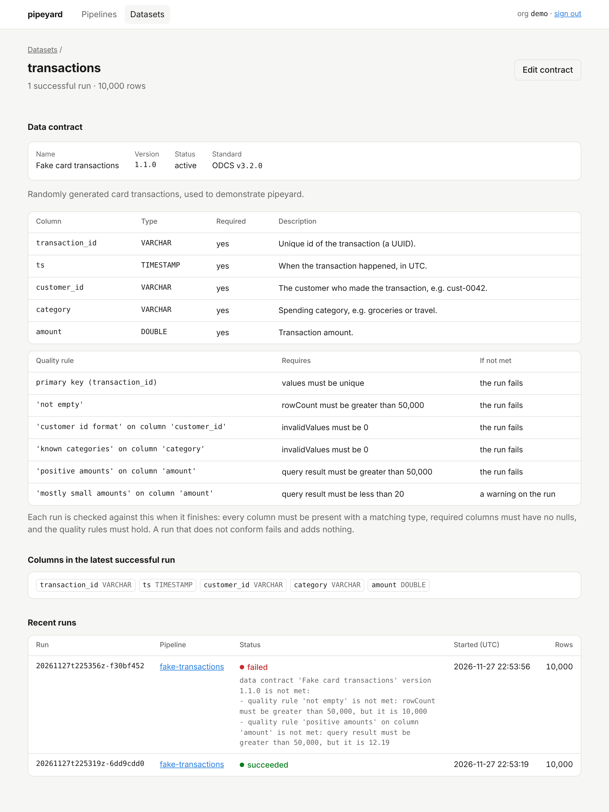

# Data contracts

A data contract is a written agreement about what a dataset contains: its columns, their
types, which ones must always be filled in, the quality rules its values must meet, who
owns it and what it is for. pipeyard uses
the [Open Data Contract Standard](https://bitol-io.github.io/open-data-contract-standard/latest/)
(ODCS), an open, vendor-neutral YAML format from the Linux Foundation's Bitol project, so
your contracts are not tied to pipeyard and can be read by other ODCS tools.

Give a dataset a contract and pipeyard holds every pipeline run to it. A run whose output
does not match **fails, with the reason, and adds nothing to the dataset**. The people
building reports can rely on the columns being what the contract says.

A contract is optional. A dataset without one accepts whatever a run writes, as before.



*A dataset's page: its contract, the quality rules and what happens when each is not met,
and its runs. Here two rules had just been tightened, so the next run failed and says
exactly why, while the earlier run's 10,000 rows remain.*

## A contract

```yaml
apiVersion: v3.2.0
kind: DataContract
id: coffee-orders
name: Coffee orders
version: 1.0.0
status: active
description:
  purpose: Every order taken at the till.
schema:
  - name: orders                  # must match the dataset's name
    properties:
      - name: order_id
        logicalType: integer
        required: true
        description: Unique per order.
      - name: ordered_at
        logicalType: timestamp
        required: true
      - name: drink
        logicalType: string
        required: true
      - name: price
        logicalType: number
        physicalType: DOUBLE
        quality:
          - name: sensible price
            type: sql
            query: SELECT max({property}) FROM {object}
            mustBeLessThan: 20
    quality:
      - name: not empty
        metric: rowCount
        mustBeGreaterThan: 0
```

`apiVersion`, `kind`, `id`, `version` and a `schema` are needed. Everything else in the
standard (service levels, team, pricing, servers, custom properties) is accepted, stored
untouched and returned when you ask for the contract back.

The example pipeline's contract is at
`examples/pipelines/fake-transactions/transactions.odcs.yaml`.

## Adding one

**In the UI:** open **Datasets**, click the dataset, and press **Add a data contract**. If
the dataset already has data, the form starts with a draft written from the columns of its
latest successful run, plus a "not empty" rule, so you are editing rather than typing from
scratch. Mistakes come
back as a list of what to fix.

**From a script:**

```sh
curl -X PUT localhost:8000/api/datasets/orders/contract \
  -H "Authorization: Bearer $TOKEN" \
  -H "Content-Type: application/yaml" \
  --data-binary @orders.odcs.yaml
```

`GET` on the same address returns the stored document, and `DELETE` removes it.

You can register a contract before the dataset has any data.

## What is checked

When a run finishes, pipeyard reads the schema from the Parquet files the run actually
wrote (not from what the container's manifest claims) and compares it with the `schema`
object named after the dataset. For each property in the contract:

| Check | Rule |
|---|---|
| **The column exists** | Looked up by `physicalName` if given, otherwise `name`. |
| **The type matches** | If `physicalType` is given, the column's type must equal it. Otherwise it must belong to the `logicalType`. With neither, only existence is checked. |
| **No nulls where required** | If `required: true`, the column must have no null values in this run. |

Columns in the data that the contract does not mention are allowed.

How logical types map to the types in your Parquet files:

| `logicalType` | Accepts |
|---|---|
| `string` | `VARCHAR`, `UUID`, `ENUM` |
| `integer` | any integer type |
| `number` | any integer, `FLOAT`, `DOUBLE`, `DECIMAL` |
| `boolean` | `BOOLEAN` |
| `date` | `DATE`, and timestamps |
| `timestamp` | timestamps, with or without a time zone |
| `time` | `TIME` |
| `array`, `object`, `map` | lists, structs, maps |

`physicalType` is compared by name, ignoring case, and understands other systems' spellings
of the same type: `string` and `varchar(18)` equal `VARCHAR`, `int` equals `INTEGER`,
`double precision` equals `DOUBLE`, and so on. `DECIMAL(18,2)` must match exactly.

## Quality rules

Beyond the schema, a contract can say what the *values* must look like. Rules go in a
`quality` list, on a property (about that column) or on the schema object (about the
whole run). pipeyard runs them against the Parquet each run wrote.

### Ready-made metrics

The standard defines a small library of metrics. Each counts something, and you say what
the count must be:

| `metric` | Goes on | Counts | Arguments |
|---|---|---|---|
| `rowCount` | schema object | rows in the run | |
| `nullValues` | property | nulls in the column | |
| `missingValues` | property | values you consider missing | `missingValues: [null, '', 'N/A']` |
| `invalidValues` | property | values that are present but not allowed | `validValues: [...]` and/or `pattern: '<regex>'` |
| `duplicateValues` | property | rows beyond the first for each repeated value | |
| `duplicateValues` | schema object | the same, across several columns together | `properties: [a, b]` |

```yaml
- name: drink
  logicalType: string
  quality:
    - name: known drinks
      metric: invalidValues
      arguments:
        validValues: [espresso, flat white, latte, filter, mocha]
      mustBe: 0
    - metric: nullValues
      unit: percent          # default is rows
      mustBeLessThan: 1
```

The comparisons are `mustBe`, `mustNotBe`, `mustBeGreaterThan`, `mustBeGreaterOrEqualTo`,
`mustBeLessThan`, `mustBeLessOrEqualTo`, `mustBeBetween: [low, high]` and
`mustNotBeBetween: [low, high]`. `unit: percent` compares the count as a percentage of
the run's rows. Patterns are regular expressions in RE2 syntax, matched anywhere in the
value unless you anchor them with `^` and `$`.

### `unique` and `primaryKey`

`unique: true` on a property means no value may repeat. `primaryKey: true` means the same
for the key, and several key columns (ordered by `primaryKeyPosition`) are checked together.

### SQL rules

For anything the library does not cover, write a query that returns one number or one
true/false value:

```yaml
quality:
  - name: sensible price
    type: sql
    query: SELECT max({property}) FROM {object}
    mustBeLessThan: 20
```

`{object}` stands for the run's data and `{property}` for the column the rule sits on. The
query is DuckDB SQL and must be a single `SELECT`. It runs in a sandbox that can read your
own org's data and nothing else, and is stopped if a contract's checks take longer than
30 seconds in total.

### Warnings instead of failures

By default a rule that is not met fails the run. Give it `severity: warning` (or `info`)
and the run succeeds, with the unmet rule recorded on the run as a warning and shown next
to it in the UI. Use this for things worth a look that should not block the data.

### Scope: one run at a time

Every rule is evaluated on the run being checked, on its own. `rowCount` is the rows *that
run* wrote, and `unique` means unique *within that run*. A value repeated across two
different runs is not caught.

### Rules that are stored but not run

`type: text` rules are descriptions for people. `type: custom` rules are written for
another engine, such as Soda or Great Expectations, which pipeyard does not run. Both are
kept, and the dataset page lists them as "not checked" so nobody mistakes them for
enforcement. `schedule` is ignored: checks happen when a run finishes.

## When a run breaks the contract

The run is marked failed and says exactly what was wrong:

```
data contract 'Coffee orders' version 1.0.0 is not met:
- column 'drink' is missing
- column 'price' is VARCHAR, the contract says DOUBLE
- column 'order_id' is required but has 12 null values
- quality rule 'not empty' is not met: rowCount must be greater than 0, but it is 0
```

As with any failed run, pipeyard deletes what it wrote, so report containers never see it.
The run record keeps the contract version it was checked against.

## Changing a contract

Save a new document over the old one; bump `version` so run records show which one applied.
A change takes effect for runs that finish afterwards. **Runs already in the dataset are
not rechecked**, so if you tighten a contract, older runs may not meet it.

## What is not enforced yet

- **Across runs.** Rules look at one run at a time, so uniqueness or totals over the whole
  dataset are not checked.
- **Service levels** (`slaProperties`, such as freshness) are not monitored.
- **`logicalTypeOptions`** (formats, minimums, patterns) are not applied; use a quality
  rule instead.
- **`text` and `custom` rules** are stored and shown, not run.
- **Large runs.** Checks run inside pipeyard's own process with a 30-second limit, which
  suits modest data volumes. A run too big to check in that time fails its contract check.
- Documents are checked for the fields pipeyard needs, not validated against the full
  official ODCS JSON Schema. The example contract in this repository has been validated
  against it.
- ODCS v2 documents are rejected; use v3.
