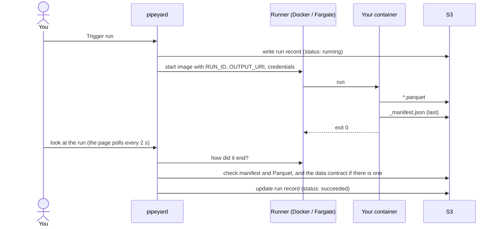
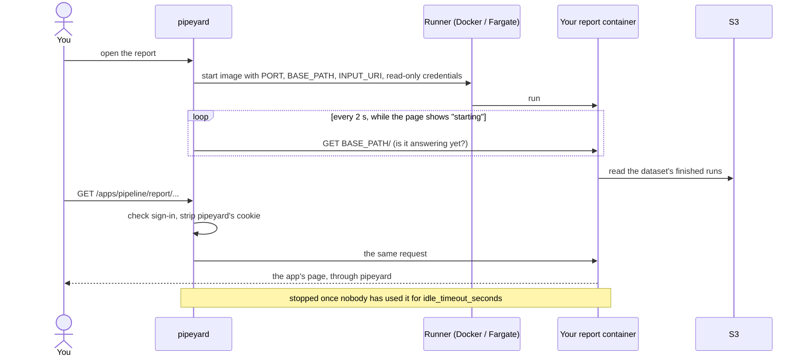

# How it works

pipeyard is one small web app, an S3 bucket, and whatever containers you give it. This page
follows a pipeline run and then a report from the button press to the screen, then covers
where things are stored, the API, and how orgs are kept apart.

## A pipeline run



Three things in that picture are worth a closer look.

**pipeyard never waits on your container.** Starting a run returns immediately. The outcome
is worked out the next time anyone reads the run: pipeyard asks the runner how the
container ended, checks the output, and saves the verdict. That is why there is no worker
process or queue to operate for runs. The cost is that a run nobody looks at stays "running" in its
record until somebody does, although opening the datasets page counts as looking.

**The run record is the source of truth.** Your container writes the data and the manifest,
but only pipeyard writes the run record, and the datasets page counts *only* the runs it
recorded as succeeded. When a run crashes, times out or writes a bad manifest, pipeyard
also deletes whatever it left in S3, so report containers never read half a run.

**Timeouts do not depend on pipeyard being up.** Locally a timer kills the container, and
if pipeyard restarts, the deadline is recomputed from the container's own start time. In
AWS each task carries a tiny sidecar that exits after `timeout_seconds`, which makes ECS
stop the task.

## Where everything is stored

One bucket, one prefix per org, six kinds of object. There is no database.

```
orgs/{org_id}/pipelines/{name}/pipeline.yaml
orgs/{org_id}/runs/{run_id}.json
orgs/{org_id}/datasets/{dataset}/run={run_id}/*.parquet
orgs/{org_id}/datasets/{dataset}/run={run_id}/_manifest.json
orgs/{org_id}/reports/{pipeline}/{slug}.json
orgs/{org_id}/contracts/{dataset}.odcs.yaml
```

| What | Format | Written by |
|---|---|---|
| Pipeline definition | YAML, exactly the text you registered | pipeyard, when you register or edit |
| Run record | One JSON object per run: status, times, row count, error | pipeyard, at start and when the run is settled |
| Data | Parquet, one or more files per run | Your container |
| Manifest | JSON: dataset, run id, row count, schema | Your container, last |
| Data contract | An ODCS YAML document, exactly as registered | pipeyard, when you add or edit one |
| Report app record | JSON: starting, running or stopped; expiry; address | pipeyard, as a report starts and stops |

Each run writes into its own `run={run_id}/` folder, so runs never overwrite each other. A
dataset is simply every finished run's folder read together.

The lists you see in the UI are DuckDB `read_json` queries over these prefixes. pipeyard never deletes or compacts anything in v0, so old runs
stay until you remove them.

## A report



A report is a web app in a container, and pipeyard is a reverse proxy in front of it.

**Started on demand.** Nothing runs until someone opens the report, which wakes it. There
is one instance per report, shared by everyone in the org.

**Reached only through pipeyard.** The browser talks to
`/apps/{pipeline}/{report}/...` on pipeyard, which checks the sign-in, removes its own
cookie and any `Authorization` header, and forwards the request, path unchanged, to the
container. WebSockets are forwarded the same way, which is what makes Streamlit-style apps
work. Locally the container is reached on a loopback port; in AWS on the task's private
address, which only pipeyard's security group may connect to.

**Scaled to zero when idle.** pipeyard notes the time of every request it forwards and
counts the WebSockets it has open to each app. Every 15 seconds it stops any app that has
no open WebSocket and has had no request for `idle_timeout_seconds` (5 minutes by default).
An open browser tab on a Streamlit-style app holds a WebSocket, so a dashboard someone is
looking at is never stopped for being quiet.

This is the one piece of pipeyard that runs on a clock. The usage notes are kept in
memory, so if pipeyard restarts it treats each running app as used at the moment it next
sees it. As a backstop, the mechanism that enforces a pipeline's timeout also stops a
report `lifetime_seconds` after it started (50 minutes at most), in use or not, because
the app's S3 credentials last an hour.

**Read-only.** A report's credentials can read its org's prefix and nothing else, and
cannot write at all.

## How orgs are kept apart

v0 serves one org per deployment, but the isolation that many orgs would need is already
in place, in three independent layers:

| Layer | What it does |
|---|---|
| **The token** | Every request's org is read from a verified sign-in token: a Cognito ID token in AWS, a locally signed stub in development. No route accepts an org in its path, query or body. |
| **The code** | S3 keys are built in one module (`contract.py`), and every helper starts from `orgs/{org_id}/`. The report proxy looks an app up by the caller's org, so another org's app does not exist as far as it can tell. |
| **IAM (AWS only)** | One role allows only `orgs/${aws:PrincipalTag/org_id}/*`. pipeyard assumes it with an `org_id` session tag and uses those credentials for your containers and for its own S3 calls. Report containers get a read-only version. pipeyard's own role has no S3 permissions at all. |

If the code layer had a bug, IAM would still refuse the request. The tests in
`tests/test_org_scoping.py` and `tests/test_reports.py` attack each layer: cross-org
requests, forged, expired and unsigned tokens, path tricks, and attempts to reach another
org's running report over HTTP and WebSocket.

One thing to be aware of: a report app is served from pipeyard's own web address, so the
JavaScript in it runs with the same standing as pipeyard's pages for whoever is viewing
it. That is fine for reports your own org wrote, which is the only kind there is.

## The API

Everything the UI does is available as JSON. Send `Authorization: Bearer <token>`; locally,
`POST /dev/token` gives you one for the org `demo`.

| Method and path | What it does |
|---|---|
| `POST /api/pipelines` | Register or replace a pipeline. The body is the YAML. Invalid YAML returns 422 with a list of errors. |
| `GET /api/pipelines` | List pipelines |
| `GET /api/pipelines/{name}` | One pipeline |
| `POST /api/pipelines/{name}/runs` | Trigger a run. Returns the run record. |
| `GET /api/pipelines/{name}/runs` | A pipeline's runs, newest first |
| `GET /api/runs/{run_id}` | One run. Poll this until `status` is no longer `running`. |
| `GET /api/datasets` | Datasets, with row counts, schema and contract summary |
| `PUT /api/datasets/{dataset}/contract` | Register or replace a dataset's data contract. The body is an ODCS document. |
| `GET`, `DELETE /api/datasets/{dataset}/contract` | Read it back as YAML, or remove it |
| `GET /api/pipelines/{name}/reports/{slug}` | A report's state: `stopped`, `starting` or `running`, and its URL. `slug` is the report name in lower case with dashes, e.g. `coffee-dashboard`. |
| `POST /api/pipelines/{name}/reports/{slug}/start` | Start the report's app. Poll the state until it is `running`. |
| `POST /api/pipelines/{name}/reports/{slug}/stop` | Stop it now |
| `ANY /apps/{name}/{slug}/...` | The running app itself, proxied |

`scripts/demo.py` is a complete client in about 130 lines of standard-library Python.

## The code, in one paragraph

`app.py` holds the routes for both the API and the UI. It resolves the org with `auth.py`,
builds keys and validates input with `contract.py`, reads and writes objects with
`storage.py`, starts and checks containers through `runner.py` (one interface, a Docker
implementation and a Fargate one), checks a run against its dataset's contract with
`datacontract.py`, forwards report traffic with `proxy.py`, and answers
the run and dataset lists with `query.py`.
`config.py` reads the environment. That is all of it.
