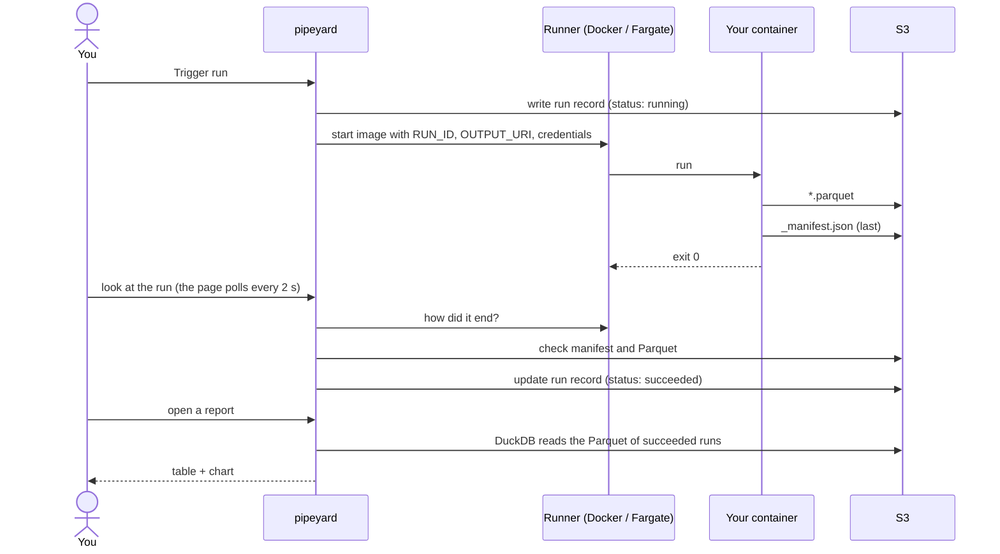

# How it works

pipeyard is one small web app, an S3 bucket, and whatever container you give it. This page
follows a run from the button press to the chart, then covers where things are stored, the
API, and how orgs are kept apart.

## A run, from click to chart



Three things in that picture are worth a closer look.

**pipeyard never waits on your container.** Starting a run returns immediately. The outcome
is worked out the next time anyone reads the run: pipeyard asks the runner how the
container ended, checks the output, and saves the verdict. That is why there is no worker
process or queue to operate. The cost is that a run nobody looks at stays "running" in its
record until somebody does, although opening the datasets page or any report counts as
looking.

**The run record is the source of truth.** Your container writes the data and the manifest,
but only pipeyard writes the run record, and datasets and reports read *only* the runs it
recorded as succeeded. A run that crashed, timed out or wrote a bad manifest contributes
nothing, even if it left files in S3.

**Timeouts do not depend on pipeyard being up.** Locally a timer kills the container, and
if pipeyard restarts, the deadline is recomputed from the container's own start time. In
AWS each task carries a tiny sidecar that exits after `timeout_seconds`, which makes ECS
stop the task.

## Where everything is stored

One bucket, one prefix per org, four kinds of object. There is no database.

```
orgs/{org_id}/pipelines/{name}/pipeline.yaml
orgs/{org_id}/runs/{run_id}.json
orgs/{org_id}/datasets/{dataset}/run={run_id}/*.parquet
orgs/{org_id}/datasets/{dataset}/run={run_id}/_manifest.json
```

| What | Format | Written by |
|---|---|---|
| Pipeline definition | YAML, exactly the text you registered | pipeyard, when you register or edit |
| Run record | One JSON object per run: status, times, row count, error | pipeyard, at start and when the run is settled |
| Data | Parquet, one or more files per run | Your container |
| Manifest | JSON: dataset, run id, row count, schema | Your container, last |

Each run writes into its own `run={run_id}/` folder, so runs never overwrite each other. A
dataset is simply every succeeded run's folder read together, and each row carries a `run`
column saying which run it came from.

The lists you see in the UI are DuckDB queries over these prefixes (`read_json` for runs,
`read_parquet` for data). pipeyard never deletes or compacts anything in v0, so old runs
stay until you remove them.

## How reports run

When you open a report, pipeyard:

1. Checks the SQL is exactly one `SELECT`. This is checked at registration too.
2. Opens a fresh, in-memory DuckDB connection for this one query.
3. Gives it credentials that only work under `orgs/{your org}/`.
4. Creates a view per dataset, each reading the Parquet of that dataset's succeeded runs.
5. Switches off all other file and network access, and locks the configuration so SQL
   cannot switch it back on.
6. Replaces `{{dataset}}` with the report's dataset and runs your SQL.

The result is capped at 5,000 rows. Because every dataset in your org is a view under its
own name, one report can join several datasets.

## How orgs are kept apart

v0 serves one org per deployment, but the isolation that many orgs would need is already
in place, in three independent layers:

| Layer | What it does |
|---|---|
| **The token** | Every request's org is read from a verified sign-in token: a Cognito ID token in AWS, a locally signed stub in development. No route accepts an org in its path, query or body. |
| **The code** | S3 keys are built in one module (`contract.py`), and every helper starts from `orgs/{org_id}/`. Report SQL runs in the sandbox described above. |
| **IAM (AWS only)** | One role allows only `orgs/${aws:PrincipalTag/org_id}/*`. pipeyard assumes it with an `org_id` session tag and uses those credentials for your container, for DuckDB and for its own S3 calls. pipeyard's own role has no S3 permissions at all. |

If the code layer had a bug, IAM would still refuse the request. The tests in
`tests/test_org_scoping.py` attack each layer: cross-org requests, forged, expired and
unsigned tokens, path tricks, and report SQL that tries to read another org's files or
`/etc/passwd`.

## The API

Everything the UI does is available as JSON. Send `Authorization: Bearer <token>`; locally,
`POST /dev/token` gives you one for the org `demo`.

| Method and path | What it does |
|---|---|
| `POST /api/pipelines` | Register or replace a pipeline. The body is the YAML. Invalid YAML returns 422 with a list of errors. |
| `GET /api/pipelines` | List pipelines |
| `GET /api/pipelines/{name}` | One pipeline |
| `POST /api/pipelines/{name}/runs` | Trigger a run. Returns the run record. |
| `GET /api/pipelines/{name}/runs` | A pipeline's runs, newest first |
| `GET /api/runs/{run_id}` | One run. Poll this until `status` is no longer `running`. |
| `GET /api/datasets` | Datasets, with row counts and schema |
| `GET /api/pipelines/{name}/reports/{slug}` | Run a report. `slug` is the report name in lower case with dashes, e.g. `daily-volume`. |

`scripts/demo.py` is a complete client in about 100 lines of standard-library Python.

## The code, in one paragraph

`app.py` holds the routes for both the API and the UI. It resolves the org with `auth.py`,
builds keys and validates input with `contract.py`, reads and writes objects with
`storage.py`, starts and checks containers through `runner.py` (one interface, a Docker
implementation and a Fargate one), and answers lists and reports with `query.py`.
`config.py` reads the environment. That is all of it.
