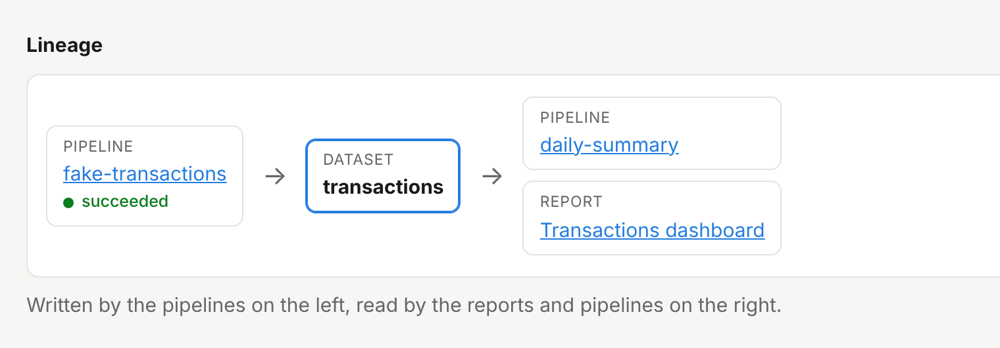

# Lineage

Lineage answers two questions: where did this data come from, and what depends on it?
pipeyard answers them in two places. Inside pipeyard, every dataset and pipeline page shows
its lineage as a small diagram. For everything beyond pipeyard, it records what it runs in
a standard format that lineage tools understand.

## Lineage inside pipeyard



Open a dataset and the **Lineage** section shows what writes it on the left, with the
result of its latest run, and what reads it on the right: reports, and any pipeline that
takes it as an input. Open a pipeline and you see the same thing from its side: the
dataset it reads, if any, then the dataset it writes, then whatever reads that. Every box
is a link, so you can walk the chain.

This is how you answer "if I change this pipeline, which reports are affected?" or "this
report looks wrong; what produces its data, and did the last run fail?" without leaving
pipeyard.

The diagram is drawn from what your `pipeline.yaml` files declare (`inputs`, `outputs` and
each report's `dataset`), so it is complete even for things that have never run. The same
information is available from `GET /api/datasets/{dataset}/lineage`.

## Lineage for other tools: OpenLineage

pipeyard also describes what it runs in [OpenLineage](https://openlineage.io), the open standard
for data lineage. Each pipeline run and each report is recorded as an event saying which
job ran, which datasets it read and which it wrote. Feed those events to any
OpenLineage-compatible tool (Marquez, DataHub, OpenMetadata, Atlan and others) and it can
draw the graph: this pipeline writes this dataset, which these reports read.

You do not have to set anything up to get the events. They are always recorded. Sending
them somewhere is one setting.

### What is recorded

| When | Event | Says |
|---|---|---|
| A pipeline run is triggered | `START` | the job, its input dataset if it declares one, its output dataset |
| The run succeeds | `COMPLETE` | plus the output's columns and row count |
| The run fails, for any reason including breaking its [data contract](data-contracts.md) | `FAIL` | plus the error message |
| A report's container is started | `START` | the report as a job, and the dataset it reads |
| The report is stopped (by you, or for being idle) | `COMPLETE` | |
| The report's container crashes or cannot start | `FAIL` | plus the error message |

Every run gets exactly one `START` and one ending, as the standard requires.

How pipeyard's things are named in the events:

| | Namespace | Name |
|---|---|---|
| A pipeline (a job) | `pipeyard/{org}` | the pipeline name, e.g. `coffee-orders` |
| A report (a job) | `pipeyard/{org}` | `{pipeline}.{report}`, e.g. `coffee-orders.coffee-dashboard` |
| A dataset | `s3://{bucket}` | `orgs/{org}/datasets/{dataset}` |

Datasets follow OpenLineage's naming convention for S3, so a tool that already knows about
the same bucket from another system will recognise them as the same datasets.

### Looking at the events

```sh
curl localhost:8000/api/runs/$RUN_ID/lineage -H "Authorization: Bearer $TOKEN"
```

returns the events for a run as a JSON list. A shortened `COMPLETE` event:

```json
{
  "eventType": "COMPLETE",
  "eventTime": "2026-11-27T22:47:46.512Z",
  "producer": "https://github.com/hungovercoders/pipeyard",
  "schemaURL": "https://openlineage.io/spec/2-0-2/OpenLineage.json#/$defs/RunEvent",
  "run": { "runId": "0b5a7c1e-6a0e-5c57-9d3a-7f2f7a8a1c11" },
  "job": { "namespace": "pipeyard/demo", "name": "fake-transactions" },
  "inputs": [],
  "outputs": [
    {
      "namespace": "s3://pipeyard",
      "name": "orgs/demo/datasets/transactions",
      "facets": { "schema": { "fields": [{ "name": "amount", "type": "DOUBLE" }] } },
      "outputFacets": { "outputStatistics": { "rowCount": 10000 } }
    }
  ]
}
```

OpenLineage run ids must be UUIDs, so each is derived from pipeyard's own run id and is the
same every time. The events are also kept in S3 under `orgs/{org}/lineage/{run_id}/`.

### Sending the events to a lineage tool

Set the address of an OpenLineage HTTP endpoint and pipeyard posts each event there as it
happens. The variable names are the ones the standard's own clients use:

| Variable | Default | Meaning |
|---|---|---|
| `OPENLINEAGE_URL` | not set | The server, e.g. `http://localhost:5000` for a local Marquez. Unset means events are only stored. |
| `OPENLINEAGE_ENDPOINT` | `api/v1/lineage` | The path events are posted to |
| `OPENLINEAGE_API_KEY` | not set | Sent as `Authorization: Bearer ...` if set |
| `OPENLINEAGE_NAMESPACE` | `pipeyard` | The first part of the job namespace |

Locally:

```sh
OPENLINEAGE_URL=http://localhost:5000 task up
```

In AWS, pass the address when deploying:

```sh
task deploy -- -c openlineage_url=https://lineage.example.com
```

Sending is best effort. Events are posted in order by a background thread; if the server is
down or answers with an error, pipeyard logs a warning and carries on. A lineage server
that is unavailable never fails or delays a run, and the events are still in S3.

## Limits

- **The diagram inside pipeyard shows declared lineage, one step each way.** It comes from
  the pipeline definitions, not from the recorded events, and shows direct writers and
  readers rather than the whole chain at once.
- **Not tested against a real lineage tool.** The events validate against the official
  OpenLineage JSON schemas, and pipeyard has been run posting to a stand-in HTTP server, but
  nobody has yet pointed it at Marquez or another product.
- **No retries.** An event that could not be delivered is not sent again. It can be read
  back from the API or S3.
- **No API key setting in the AWS stack.** `OPENLINEAGE_URL` can be set at deploy time;
  an API key would need to be stored as a secret, which the stack does not do yet.
- **Reports read what was there when they loaded.** A report's event names its dataset,
  not the specific runs it read.
- **Data-contract results are not attached** to the events as OpenLineage quality
  assertions. A broken contract shows up as a `FAIL` with the reasons in its message.
