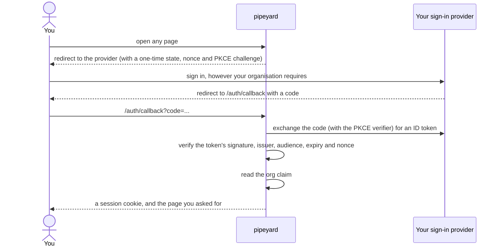

# Signing in

pipeyard needs to know two things about whoever is using it: that they are who they say,
and which org they belong to. It gets both from a signed token, and it supports the open
standard for obtaining one, [OpenID Connect](https://openid.net/developers/how-connect-works/)
(OIDC). That means you can put pipeyard behind the sign-in your organisation already uses:
Okta, Microsoft Entra ID, Google, Keycloak, Auth0, AWS Cognito, or anything else that
speaks OIDC.

With OIDC, **pipeyard never sees a password**. The browser is sent to your provider, the
person signs in there (with whatever multi-factor rules you have), and the provider sends
them back with proof.

## The three ways in

| | When it is used | What happens |
|---|---|---|
| **OpenID Connect** | Whenever `PIPEYARD_OIDC_ISSUER` is set | Sign-in happens at your provider |
| **Cognito password form** | In AWS, with no provider configured and no HTTPS address | pipeyard shows a form and checks it against a Cognito user pool |
| **Dev stub** | Locally, with nothing configured | Everyone is signed in as the org `demo`. No passwords at all. |

Configuring a provider switches the other two off, including the dev stub's tokens.

## Connecting a provider

You need three things from your provider, and one thing to give it.

**1. Register pipeyard as an application** (a "client") in the provider. Choose the
authorization code flow; PKCE is used, so a public client with no secret is fine.

**2. Give the provider pipeyard's redirect address:**

```
https://<where pipeyard lives>/auth/callback
```

**3. Arrange for each person's ID token to say which org they are in.** This is the one
unusual step. pipeyard reads a claim, `org_id` by default, whose value is a short lowercase
name such as `acme`. Every provider has a way to add a claim from a user attribute or a
group: a "protocol mapper" in Keycloak, a "claim" on the authorization server in Okta,
"optional claims" or an extension attribute in Entra ID, a custom attribute in Cognito.
Someone whose token has no such claim can sign in at the provider but is turned away by
pipeyard with a message saying what is missing.

**4. Tell pipeyard about the provider:**

| Variable | Example | Meaning |
|---|---|---|
| `PIPEYARD_OIDC_ISSUER` | `https://idp.example.com/realms/acme` | The provider's issuer address. pipeyard reads the rest from its `/.well-known/openid-configuration`. |
| `PIPEYARD_OIDC_CLIENT_ID` | `pipeyard` | The client you registered |
| `PIPEYARD_OIDC_CLIENT_SECRET` | | Only if you registered a confidential client |
| `PIPEYARD_OIDC_ORG_CLAIM` | `org_id` | The claim that names the org. Default `org_id`. |
| `PIPEYARD_OIDC_SCOPES` | `openid email profile` | What to ask the provider for. This is the default. |
| `PIPEYARD_PUBLIC_URL` | `https://pipeyard.example.com` | Where browsers reach pipeyard. Needed behind a load balancer, so the redirect address is right. |
| `PIPEYARD_SESSION_HOURS` | `8` | How long a browser stays signed in |
| `PIPEYARD_SESSION_SECRET` | | Optional. A long random string. Without it, restarting pipeyard signs everyone out. |

### Trying it locally with Keycloak

```sh
docker run -p 8080:8080 -e KC_BOOTSTRAP_ADMIN_USERNAME=admin \
  -e KC_BOOTSTRAP_ADMIN_PASSWORD=admin keycloak/keycloak start-dev
```

In its admin console at <http://localhost:8080>: create a realm, a client called `pipeyard`
with redirect address `http://localhost:8000/auth/callback`, a user attribute `org_id`
with a mapper that adds it to the ID token, and a user whose `org_id` is `demo`. Then:

```sh
PIPEYARD_OIDC_ISSUER=http://localhost:8080/realms/<your realm> \
PIPEYARD_OIDC_CLIENT_ID=pipeyard task up
```

Open <http://localhost:8000> and you are sent to Keycloak to sign in.

### In AWS

See [deploying to AWS](deploy-aws.md#signing-in). In short: bring a domain and certificate
and the stack uses Cognito's hosted sign-in page through OIDC; or pass `-c oidc_issuer=...`
to use your own provider and create no Cognito user pool at all.

## What happens when someone signs in



After that, the browser holds a session cookie that pipeyard signed itself. It names the
person and their org, cannot be read by scripts, and lasts `PIPEYARD_SESSION_HOURS`. When
it expires, the next page load goes back through the provider, which is usually invisible
if you are still signed in there.

## Calling the API

Scripts send the provider's **ID token** as `Authorization: Bearer <token>`. pipeyard
verifies it the same way: signature against the provider's published keys, issuer,
audience (your client id), expiry, and the org claim. How a script obtains an ID token is
between it and your provider.

## Signing out

**sign out** ends pipeyard's session and shows a signed-out page. It does not sign you out
of your provider, so pressing **Sign in** again may bring you straight back without asking
for a password. Sign out at the provider as well if you are on a shared machine.

## What is checked, and what is not

Checked on every sign-in and every API call:

- The token is signed by the provider's own key, with an algorithm that needs a private
  key. Tokens signed with a shared secret are never accepted as provider tokens.
- It was issued by your provider, for your client, and has not expired.
- A sign-in response matches the request that started it (`state`), was not replayed from
  another attempt (`nonce`), and the code is exchanged with the PKCE verifier.
- The org claim is present and is a valid org name.

Not done yet:

- **Signing out at the provider** (single logout).
- **Refreshing sessions silently.** When the session ends, the browser is redirected
  through the provider. A report that is open at that moment needs a page reload.
- **Roles.** Everyone in an org can do everything in it.
- **Access tokens.** The API accepts ID tokens only.

Tested against Keycloak 26 with a real browser, and against a stand-in provider in the
automated tests. Cognito's hosted page, Okta, Entra ID and Google follow the same standard
but have not been tried.
